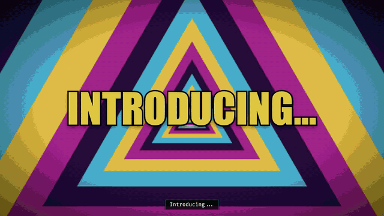
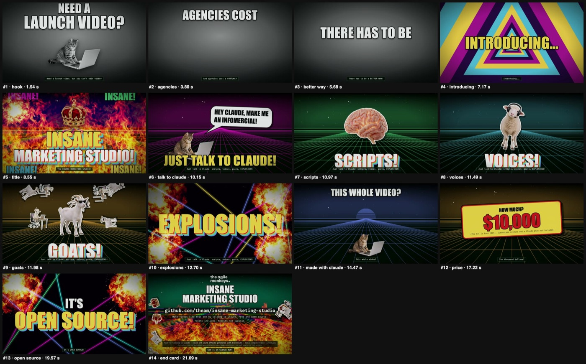

<div align="center">

<a href="https://github.com/theam/insane-marketing-studio/releases/download/v0.2.0/insane-marketing-studio.mp4"></a>


https://github.com/user-attachments/assets/cc4b4902-99be-4ea9-ad70-fdf4617aa5a4


# Insane Marketing Studio

**Make insane marketing videos by talking to Claude.**

The infomercial above was made by asking Claude Code for it. No video editor, no agency, no timeline: a script with
tone tags, an ElevenLabs voice, photo cut-outs, fire, explosions and the price gag, mixed and mastered for social.<br>
**[▶ Watch it with sound](https://github.com/theam/insane-marketing-studio/releases/download/v0.2.0/insane-marketing-studio.mp4)** (25 s) · it cost about ten cents of ElevenLabs credits.

[Install](#install) · [Make a video](#make-a-video) · [How it works](#how-it-works) · [Setup in detail](docs/setup.md) · [MIT License](LICENSE)

</div>

---

## Install

You need a Mac, [Claude Code](https://code.claude.com) (the `claude` command or the Claude desktop app's Code tab),
[Homebrew](https://brew.sh) and an [ElevenLabs](https://elevenlabs.io) account. Then, in Terminal:

```sh
claude plugin install insane-studio --marketplace theam/insane-marketing-studio
```

or inside a Claude Code session:

```text
/plugin install insane-studio --marketplace theam/insane-marketing-studio
```

That's all you install by hand. The first time you ask for a video, Claude sets up the rest on your Mac (ffmpeg, a
headless browser to draw the frames, macOS's image tools; about five minutes) and asks how to reach ElevenLabs: an API
key, or the ElevenLabs connector you can add to Claude in two clicks. [Setup in detail](docs/setup.md).

## Make a video

Start a session in a folder of your choice and ask:

> Make me a 30-second infomercial for our Friday demo day.

or type `/insane-studio:make-video`. Claude asks everything it needs in one message (say "defaults" to take its
suggestions), then works like a production with you as the director:

1. **Concept and script.** Three pitches, then the script with tone tags and the words each animation lands on. You
   approve it before any audio is made.
2. **Storyboard.** A picture of every shot, as a contact sheet and as a page where you mark each one OK or Change.
3. **v1.** The finished MP4 opens in QuickTime. Say what's wrong ("the beeps are too loud", "faster", "the goat earlier");
   Claude fixes it and renders again.
4. **The extras.** A 30-45 s social cut taken from the long one, covers (PNG, and a JPEG under 5 MB for X), credits and
   AI disclosure, and a release on GitHub if you want one.

It asks before spending money and before publishing anything.

**Two styles.** The **infomercial**: frantic slopcore late-night TV with Impact meme type, photo cut-outs, CRT
scanlines, fire, explosions and the price slash. The **explainer**: calm and clear, dark, monospace, a real product
screen.

## How it works



*The storyboard of the video above: one tile per shot, each starting on its word.*

- **Every frame is a web page.** `video.html` draws the picture for any moment `t`; Playwright screenshots it frame by
  frame and pipes the frames to ffmpeg. Same inputs, same video, every time.
- **Every animation lands on a word.** The script marks words with `{#cue}`; the narration's word timestamps
  (ElevenLabs, or Scribe speech-to-text) turn them into times. Change a line and the whole video re-times itself.
- **The voice is cut like a 90s toy commercial.** One take per sentence, placed by its audible edges with 0.05-0.15 s
  gaps, time-stretched to tempo, checked with speech-to-text. Redo one line without touching the rest.
- **The music changes where the story turns.** A bed composed with ElevenLabs Music in sections that start on the
  narration's turning points (or a track you have the rights to, re-cut per section); sound effects levelled by family so nothing
  is shrill.
- **Mastered for social.** -14 LUFS with a limiter, AAC 384 kbps at 48 kHz, BT.709, and it always ends on black. A check
  fails the video if any of that is off.

```
brief ──▶ script ──▶ storyboard ──▶ voice ──▶ word timing ──▶ music + effects ──▶ mix ──▶ render ──▶ master ──▶ social cut, covers
            ▲             │ notes                                                                        │
            └─────────────┴──────────────────────── your notes, at every checkpoint ◀────────────────────┘
```

## What's inside

| Skill | What it does |
|---|---|
| **make-video** | The entry point: the brief in one message, then everything below, with you at five checkpoints (concept, script, storyboard, v1, delivery). |
| setup | Installs and checks the tools, the keys file and the ElevenLabs connector. |
| script | Concept pitches and the script: sections, tone tags, `{#cue}` marks, the infomercial's structure and humour rules. |
| storyboard | A contact sheet of every cut and a review page with one card per shot, OK / Change and notes. |
| voice | ElevenLabs Eleven v4 narration in sentence takes, tight gaps, tempo, retakes and a speech-to-text check; by key or through the connector. |
| music-and-sfx | A music bed whose sections start at the story's turning points, re-fitted per section; soft, levelled sound effects. |
| plates-and-cutouts | Codex image generation, macOS Vision cut-outs, chroma keying, the starter cut-outs. |
| generated-clips | Optional Seedance video clips with a cost estimate, your approval, a cap and a ledger; lip sync, speed ramps, screen corner-pinning. |
| motion-and-render | The `video.html` page (every cut on its cue) and the frame-by-frame render. |
| mix-and-master | Ducked bed, effects by family, -14 LUFS, and the delivery checks. |
| social-cut-and-covers | The social cut from the long one's own cut times, re-mixed; covers. |
| deliver | A repository for the project with Git LFS, a secret scan before every push, a release, credits and posting copy. |

- [`scripts/`](scripts): the tools, all run through one command, `studio` (`studio help`).
- [`engine/`](engine): the motion engine and its two styles, open fonts, fire and explosions, 19 starter cut-outs.
- [`templates/`](templates): a starter project per style and the storyboard page.
- [`references/`](references): [lessons](references/lessons.md) and [failures](references/failures.md) from a real
  production, [what things cost](references/spend.md), [content rules](references/content-rules.md), the
  [ElevenLabs connector, tested](references/elevenlabs-mcp.md), [the engine's blocks](references/engine.md).

## Born from a real production

The kit is the production of the **INSANE Shepherdr infomercial**, a 2½-minute slopcore infomercial for
[Shepherdr](https://github.com/theam/shepherdr), our open-source macOS console for coding agents, made in three days by
Claude Code sessions with one human directing. It went down so well that we wanted the style for everything, so we
turned the production into skills. Its lessons, its failures and what it cost are in
[the case study](references/case-study-shepherdr.md).

## Contributing

Issues and pull requests are welcome: new blocks, new styles, lessons from your own productions. See
[CONTRIBUTING.md](CONTRIBUTING.md); security reports go through [SECURITY.md](SECURITY.md).

## License

The code and docs are [MIT](LICENSE). The starter cut-outs, fire and explosions are
[CC BY 4.0](https://creativecommons.org/licenses/by/4.0/). The Agile Monkeys' name and wordmarks are trademarks and
aren't licensed ([details](references/credits-and-licenses.md)). What you generate is governed by the terms of the service that made it.

<div align="center">

Made with goats by **[The Agile Monkeys](https://theagilemonkeys.com)**.

</div>
